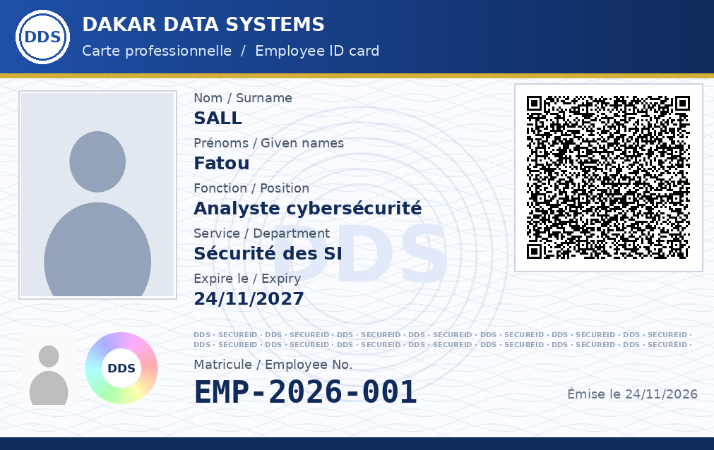
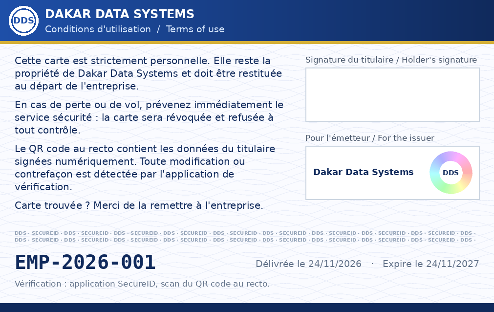
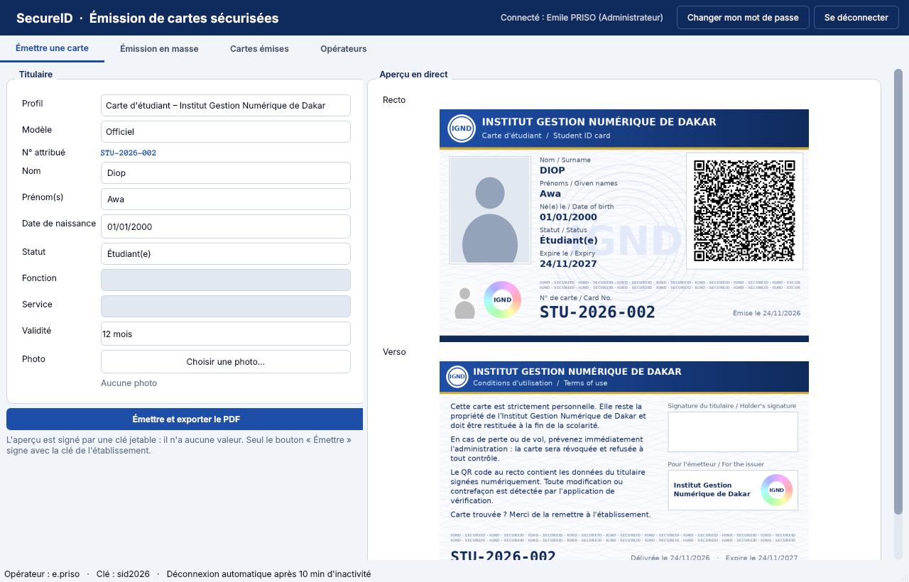
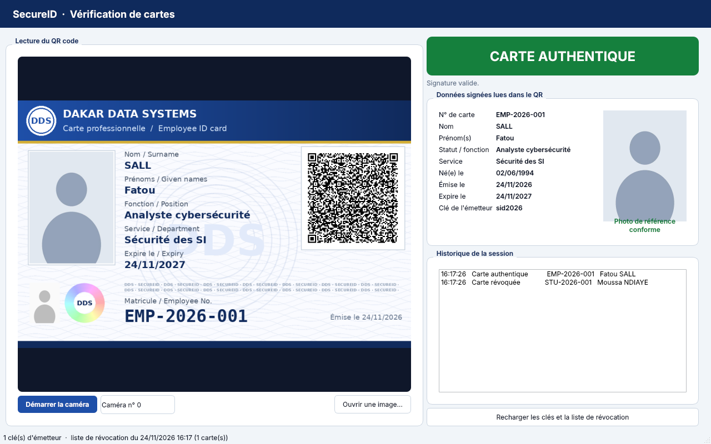
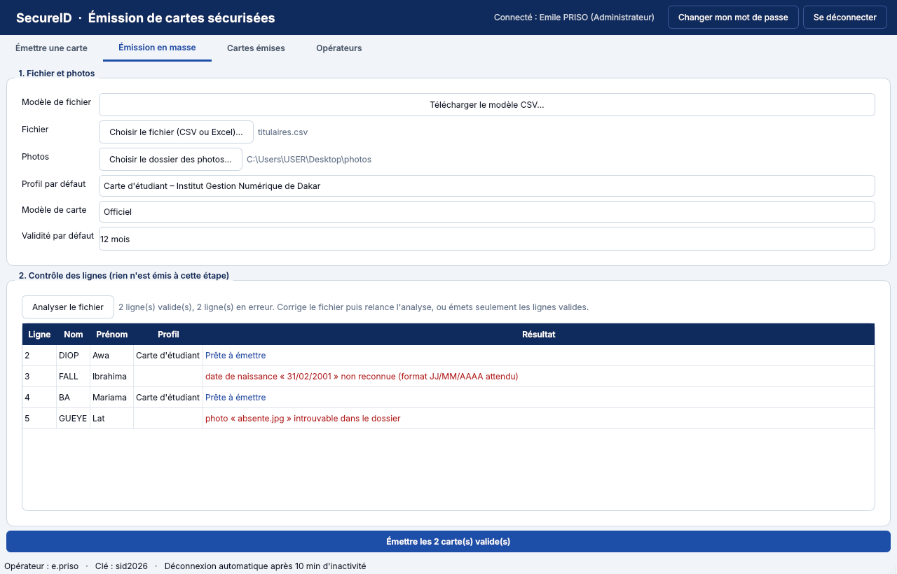
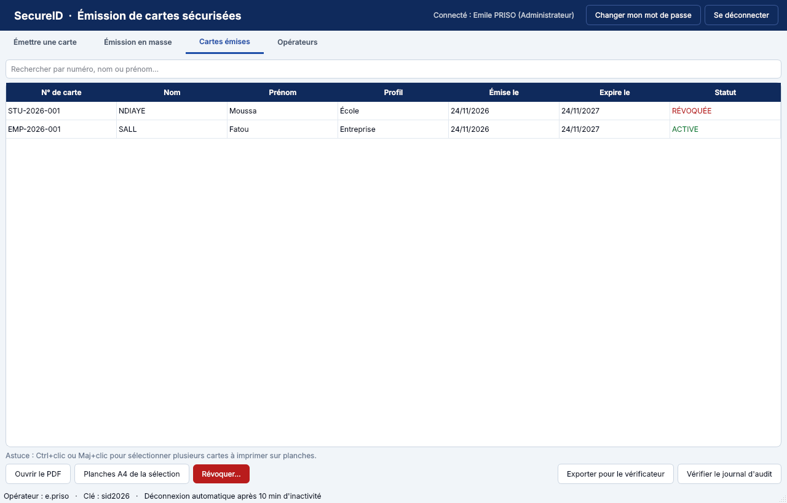
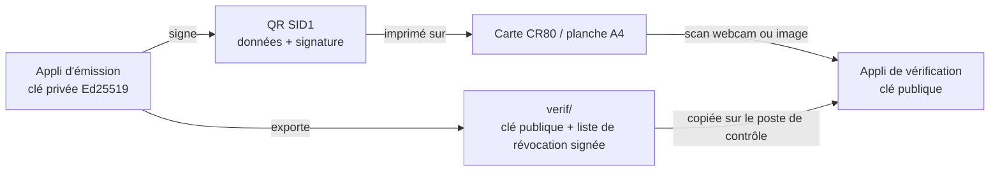

# SecureID — cartes d'identité numériques infalsifiables


SecureID émet des cartes d'identité (étudiants, employés) dont l'authenticité se vérifie **hors ligne** grâce à un
**QR code signé numériquement (Ed25519)**. Une carte modifiée, fabriquée, révoquée ou expirée est détectée au scan.

Projet personnel de portfolio, réalisé pendant mon Master 2 Sécurité des Systèmes d'Information (ESTM, Dakar).

<p align="center">
  
  
</p>

> Toutes les personnes, organisations (« Institut Gestion Numérique de Dakar », « Dakar Data Systems ») et photos
> de ce dépôt sont **fictives**.

## Fonctionnalités

**Application d'émission** (`python -m apps.issuer`)
- Saisie du titulaire avec **aperçu en direct** du recto et du verso, profils **école** ou **entreprise**.
- 4 modèles de carte ; le modèle *Officiel* intègre des sécurités visuelles : guilloches, filigrane, micro-texte,
  image fantôme, pastille irisée.
- **Signature** de chaque carte, enregistrement en base, export PDF au format réel CR80 (85,6 × 54 mm).
- **Émission en masse** depuis un fichier CSV ou Excel et un dossier de photos, avec contrôle ligne par ligne
  avant toute émission et rapport final.
- **Planches A4** de 10 cartes avec traits de coupe ; les versos sont en miroir pour l'impression recto-verso.
- **Révocation** avec motif, et **liste de révocation signée** exportée pour les postes de contrôle.
- **Comptes opérateurs** : mots de passe Argon2id, rôles administrateur et opérateur, verrouillage après 5 échecs,
  déconnexion automatique après 10 minutes d'inactivité.
- **Journal d'audit chaîné par hachage** : toute ligne modifiée ou supprimée est détectée.

**Application de vérification** (`python -m apps.verifier`)
- Lecture du QR par **webcam** ou depuis une image.
- Verdict immédiat : authentique, falsifiée, révoquée, expirée ou illisible.
- Affichage des données signées et, si la photo de référence est disponible, contrôle de son empreinte.
- Fonctionne **sans réseau** grâce à un dossier de confiance (clé publique + liste de révocation signée).

| Émission | Vérification |
|---|---|
|  |  |
|  |  |

## Comment ça marche



1. L'émetteur signe les données du titulaire avec sa **clé privée** (jamais stockée en clair).
   Le QR contient `SID1.<données en base64url>.<signature>`.
2. Le vérificateur ne détient que la **clé publique** : il peut contrôler une carte, pas en fabriquer.
3. Il vérifie dans l'ordre : format, signature, date d'expiration, liste de révocation, puis photo.

Le détail des menaces couvertes et des limites assumées se trouve dans le [modèle de menaces](docs/threat-model.md).

## Installation

Prérequis : Python 3.11 ou plus récent, et une webcam pour le scan en direct.

```bash
git clone https://github.com/emilepri/secureid.git
cd secureid
python -m venv .venv
.venv\Scripts\activate          # Windows  (Linux/macOS : source .venv/bin/activate)
pip install -r requirements.txt
python -m pytest -q             # 71 tests
```

## Utilisation

```bash
python -m apps.issuer       # émission : déverrouillage de la clé, puis connexion opérateur
python -m apps.verifier     # vérification hors ligne
python -m scripts.demo_carte --profil entreprise   # carte de démonstration en PDF
python -m scripts.apercu_modeles                   # aperçu des 4 modèles
```

Au premier lancement de l'application d'émission :
1. choisir le mot de passe qui protège la clé de signature ;
2. créer le compte administrateur ;
3. se connecter, émettre des cartes, puis cliquer sur **« Exporter pour le vérificateur »**
   et copier le dossier `verif/` sur les postes de contrôle.

Les dossiers `keys/`, `data/`, `sortie/` et `verif/` sont exclus du dépôt (`.gitignore`).

## Installer sans Python (Windows)

Télécharge **SecureID-Setup-x.y.z.exe** dans les [Releases](https://github.com/emilepri/secureid/releases), lance-le,
puis ouvre « SecureID Émission » ou « SecureID Vérification » depuis le Bureau ou le menu Démarrer.
L'installateur est construit automatiquement par GitHub Actions (workflow `windows-installer`).

## Exécutables Windows (construction manuelle)

```bat
build.bat
```

Le script produit `dist\SecureID-Emission\SecureID-Emission.exe` et `dist\SecureID-Verification\SecureID-Verification.exe`,
utilisables sans installer Python. Les deux exécutables partagent leurs données dans `%USERPROFILE%\SecureID`
(clé, base, PDF, dossier `verif`). La variable d'environnement `SECUREID_HOME` permet de choisir un autre dossier.

## Structure

```
core/        logique métier, sans interface : crypto, jeton, rendu, PDF, audit, comptes, lots, vérification
db/          modèles SQLAlchemy (SQLite)
apps/        interfaces PySide6 : issuer (émission) et verifier (contrôle)
scripts/     démos et génération des captures
tests/       71 tests pytest (cryptographie, falsification, révocation, audit, comptes, interface)
docs/        modèle de menaces et captures d'écran
```

## Choix de sécurité

| Sujet | Choix |
|---|---|
| Signature | Ed25519 (`cryptography`), clé privée chiffrée en PKCS#8 par mot de passe |
| Données dans le QR | Minimisées : identité, dates, statut et empreinte de la photo |
| Révocation hors ligne | Liste signée par l'émetteur, refusée si elle est altérée |
| Comptes | Argon2id, message d'erreur identique compte inconnu / mauvais mot de passe, verrouillage 5 min |
| Traçabilité | Journal d'audit chaîné par SHA-256, vérifiable depuis l'interface |
| Imports | Contrôle complet avant émission, noms de photos sans chemin (pas de lecture hors du dossier) |

## Pistes d'évolution

- Signer périodiquement le dernier hash du journal d'audit, pour détecter une réécriture complète de la chaîne.
- Stocker la clé de signature dans un module matériel (HSM, carte à puce) plutôt que dans un fichier.
- Application de vérification mobile.
- Puce NFC avec défi-réponse contre la copie à l'identique d'une carte valide.

## Auteur

**Emile Abdoulaye PRISO** — Master 2 Sécurité des Systèmes d'Information, ESTM Dakar ·
[github.com/emilepri](https://github.com/emilepri)

Licence MIT.
